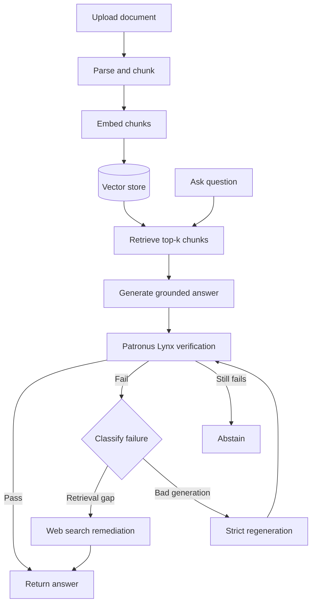

# AOA — Answer or Abstain

AOA is a document-based retrieval-augmented generation (RAG) API. Users upload
documents, ask questions, and receive answers grounded in the retrieved
content. Every generated answer is checked for faithfulness with Patronus
Lynx. When verification fails, the system distinguishes between a retrieval
gap and a bad generation before choosing web verification, strict
regeneration, or a safe abstention.

This repository contains the backend service. The frontend is maintained
separately in [`ashraddhansh/frontend-AOA-LLM`](https://github.com/ashraddhansh/frontend-AOA-LLM).

## License

This project is licensed under the GNU General Public License, version 3.
See [`LICENSE`](./LICENSE) for the complete license text.

## How it works



### Pipeline

1. **Ingestion** parses PDF, DOCX, and text files, chunks their contents,
   creates embeddings, and stores source metadata with each vector.
2. **Retrieval** embeds the question and returns the most relevant chunks
   together with similarity scores.
3. **Generation** asks the configured LLM to answer only from the retrieved
   context.
4. **Verification** sends the exact question, answer, and generation context
   to Patronus Lynx for a faithfulness judgment.
5. **Classification** uses the top retrieval score to distinguish:
   - `retrieval_gap`: relevant source context was not found, so web
     verification may be appropriate.
   - `bad_generation`: relevant context was found but the answer was not
     faithful, so the answer is regenerated with stricter grounding.
6. **Remediation** performs one controlled retry. If the answer still cannot
   be verified, the API returns an insufficient-information response rather
   than an unverified answer.

The complete design rationale and state model are documented in
[`rag-system-lld.md`](./rag-system-lld.md).

## Technology

- Python 3.11+
- FastAPI and Uvicorn
- LlamaIndex for parsing, chunking, embeddings, and retrieval
- Chroma for persistent vector storage
- LangGraph-style pipeline orchestration
- Groq for answer generation
- Patronus Lynx for faithfulness verification
- SerpAPI or the configured web-search provider for remediation
- PostgreSQL with SQLAlchemy and Alembic for application data

## Repository layout

```text
backend/
├── api/            FastAPI application, routes, schemas, and state
├── classification/ Failure classification
├── db/             SQLAlchemy models, repositories, and migrations
├── generation/     LLM prompts and answer generation
├── ingestion/      File loading, chunking, and embedding
├── remediation/    Web-search and regeneration flows
├── retrieval/      Similarity retrieval
└── verification/   Patronus Lynx integration
tests/unit/         Unit tests with external services mocked
docs/               Database, deployment, and remediation notes
```

## Requirements

- Python 3.11 or newer
- [`uv`](https://docs.astral.sh/uv/)
- PostgreSQL for the application database
- API credentials for the generation, verification, and web-search providers

## Local setup

Clone the repository, create the environment from the lockfile, and activate
it:

```bash
uv sync
source .venv/bin/activate
```

Copy the example environment file and set the required values:

```bash
cp .env.example .env
```

At minimum, configure `DATABASE_URL`, `GROQ_API_KEY`, `PATRONUS_API_KEY`,
`SERPAPI_API_KEY` (or `WEB_SEARCH_API_KEY`), and `AUTH_SECRET_KEY`.
`GOOGLE_CLIENT_ID` is required only when Google sign-in is enabled. Keep all
credentials in `.env`; never commit them.

Run the database migrations:

```bash
uv run alembic upgrade head
```

Start the API in development mode:

```bash
uv run uvicorn backend.api.main:app --reload
```

The service is available at `http://localhost:8000`. Interactive API
documentation is available at
[`/docs`](http://localhost:8000/docs), and the health endpoint is
[`/health`](http://localhost:8000/health).

## API surface

The current service exposes:

- `POST /auth/register`
- `POST /auth/login`
- `POST /auth/google`
- `GET /health`
- `POST /chats`
- `GET /chats`
- `GET /chats/{chat_id}/messages`
- `POST /chats/{chat_id}/questions`
- `POST /chats/{chat_id}/documents`

Use the generated OpenAPI documentation at `/docs` for request and response
schemas.

## Testing and quality

Run the unit test suite:

```bash
uv run pytest tests/unit -v
```

Run the full test suite with coverage:

```bash
uv run pytest --cov=backend --cov-report=term-missing
```

Run the static checks used by the project:

```bash
uv run ruff check .
uv run black --check .
uv run mypy backend/
```

Tests must mock Groq, Patronus, web search, and other external services.
Failure paths are part of the contract: API failures must produce an explicit
unverified or abstaining result rather than silently returning an answer.

## Configuration

The main tuning values are:

- `RETRIEVAL_SCORE_THRESHOLD`: score below which a verification failure is
  classified as a retrieval gap.
- `EMBED_DIM`: dimension used by the local hash embedding model.
- `CHROMA_PERSIST_DIR`: local Chroma persistence directory.
- `GROQ_MODEL` and `GROQ_WEB_MODEL`: generation models.

See [`.env.example`](./.env.example), [`docs/database.md`](./docs/database.md),
and [`docs/deployment.md`](./docs/deployment.md) for environment and
deployment details.

## Deployment

The backend can be built as a platform-neutral container. See
[`docs/container-deployment.md`](./docs/container-deployment.md) for Docker
build, runtime configuration, migration, and local Compose instructions.

The repository includes a Render blueprint in [`render.yaml`](./render.yaml).
It runs migrations before starting Uvicorn:

```bash
uv run alembic upgrade head
uv run uvicorn backend.api.main:app --host 0.0.0.0 --port "$PORT"
```

For vector-store migration guidance, see
[`docs/chroma-migration.md`](./docs/chroma-migration.md).

## Design principles

- Never return an answer that failed faithfulness verification without clearly
  marking it as unverified.
- Preserve the exact retrieved context used for generation when calling Lynx.
- Classify the failure before selecting remediation.
- Limit regeneration retries to one.
- Surface ingestion and provider failures explicitly.
- Abstain when no reliable, grounded answer can be produced.
