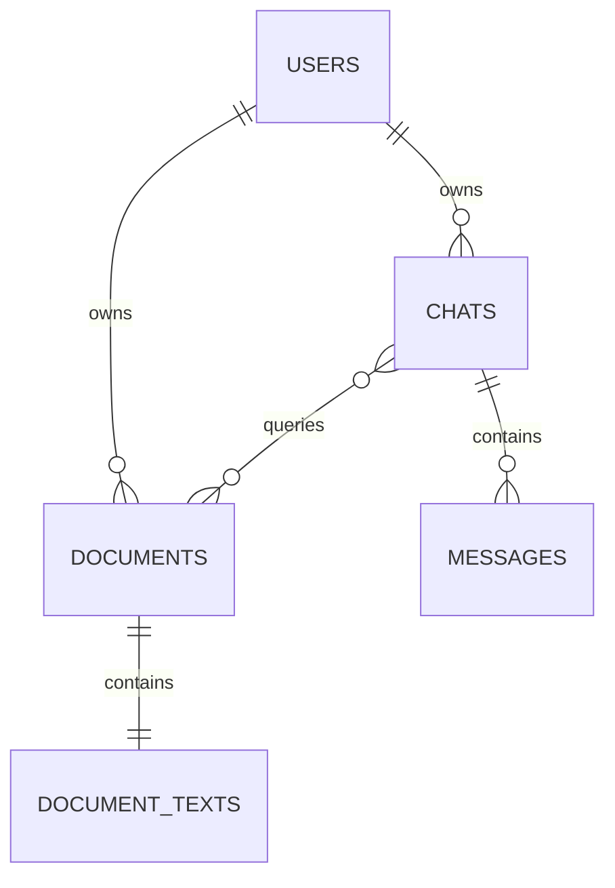

# PostgreSQL database layer

The relational database stores ownership, document lifecycle, chat history, and
RAG evaluation metadata. Document chunks and embeddings are stored in the
persistent Chroma collection configured by `CHROMA_PERSIST_DIR`. The current
local embedding implementation is 256-dimensional, so the default is
`EMBED_DIM=256`.

## Entity relationship diagram



`chat_documents` is the join table for the many-to-many chat/document
relationship. All child foreign keys cascade on deletion. Chroma data is stored
separately from the relational tables.

## Tables

- `users`: minimal identity record with a case-insensitive unique email.
- `documents`: owned upload metadata and processing status.
- `document_texts`: extracted text separated from list queries.
- `chats`: owned conversation metadata and update ordering.
- `chat_documents`: documents available to a chat.
- `messages`: conversation content plus verification, retrieval, and web-source
  metadata used by the UI and evaluation statistics.

## Migrations

Set `DATABASE_URL` in `.env` for the target database. For development and
tests, set `TEST_DATABASE_URL` to a separate local PostgreSQL database. Never
point tests at Render.

```bash
uv run alembic upgrade head
uv run alembic downgrade -1
uv run alembic revision --autogenerate -m "describe change"
uv run alembic current
```

To apply the initial schema to Render, after confirming `DATABASE_URL` points to
the intended Render database:

```bash
uv run alembic upgrade head
```

No credentials are included in this document or command. Do not run
`downgrade base`, `DROP`, or `TRUNCATE` against Render without explicit
confirmation.

## Authentication and persisted history

The API exposes `/auth/register` and `/auth/login` for email/password
accounts, plus `/auth/google` for Google Identity Services ID tokens. Set
`AUTH_SECRET_KEY` to a long random value and `GOOGLE_CLIENT_ID` to the Google
web client ID. Authenticated requests send
`Authorization: Bearer <access_token>`. `/chats`, `/chats/{id}/messages`, chat
uploads, and questions are ownership-scoped to that authenticated user. The
frontend stores only the short-lived bearer token and loads chat history from
these endpoints after sign-in.

## Vector storage

The current API creates a persistent Chroma client at `CHROMA_PERSIST_DIR` and
uses it for ingestion and retrieval. Mount durable storage at that path in
container deployments. PostgreSQL stores application records only; its
vector extension is not required by the current backend.
