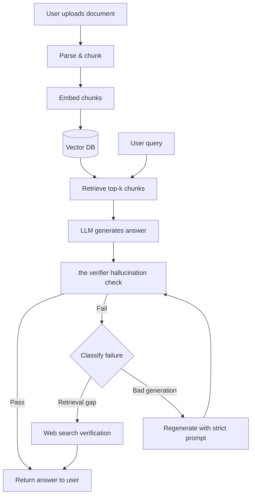

# Low-Level Design: Document RAG System with Hallucination & Web Verification

**Version:** 1.0
**Status:** Draft

## 1. Overview

A general-purpose RAG system where users upload documents and ask questions. Answers are generated using retrieved context, then checked for hallucination using the configurable verification model. Flagged answers are routed through a diagnostic step and either re-verified against the web or regenerated with stricter grounding.

**Core goals**
- Accurate, document-grounded answers
- Automatic hallucination detection on every response
- Smart remediation: don't blindly re-search the web for every failure type
- Transparent fallback when no reliable answer exists

## 2. Tech Stack

| Layer | Tool | Purpose |
|---|---|---|
| Document parsing, chunking, embedding, retrieval | **LlamaIndex** | Ingest uploaded files, build vector index, retrieve relevant chunks |
| Vector storage | **Chroma** | Persist and query chunk embeddings |
| Orchestration / control flow | **LangGraph** | Manage the multi-step, branching pipeline as a state graph |
| Answer generation | LLM (e.g. Claude) | Generate answers from retrieved context |
| Hallucination detection | **the configurable verification model** | Score answer faithfulness against retrieved context |
| Web verification | Search API (Tavily/SerpAPI) | Cross-check claims when retrieval appears insufficient |

## 3. System Architecture



## 4. Pipeline Stages — Detail

### 4.1 Ingestion (runs once per uploaded document)
1. Load file (LlamaIndex readers: PDF, DOCX, TXT, etc.)
2. Chunk text (~512 tokens, slight overlap — tune empirically)
3. Embed each chunk
4. Store vectors + metadata (source doc, page, chunk id) in vector DB

### 4.2 Query-time retrieval
1. Embed the user's query
2. Similarity search, top-k (start k=5)
3. Capture **retrieval scores** — this is the key diagnostic signal used later to distinguish failure types

### 4.3 Generation
- Prompt = retrieved chunks + question, instructed to answer only from context and say "I don't know" if absent
- Output: raw answer text

### 4.4 Hallucination check (the verifier)
Inputs sent to the verifier:
- `evaluated_model_input`: the question
- `evaluated_model_output`: the LLM's answer
- `evaluated_model_retrieved_context`: the exact chunks used at generation time (must match verbatim)

Output: pass/fail + explanation. the verifier checks **faithfulness to context**, not real-world truth.

### 4.5 Failure classification
Distinguishes two different root causes before deciding remediation:

| Signal | Failure type | Meaning | Remediation |
|---|---|---|---|
| Top retrieval score below threshold | `retrieval_gap` | No relevant chunk existed | Web search |
| Retrieval score healthy, the verifier still fails | `bad_generation` | Model ignored/misread good context | Regenerate with stricter prompt |

Threshold is empirical — calibrate against real examples from your own documents.

### 4.6 Remediation paths
- **Web search verification**: search the live web for the query, generate a fresh answer from those results, label it clearly as "not from your documents"
- **Strict regeneration**: re-prompt LLM against the *same* chunks with tighter grounding instructions (e.g. "quote directly from context"); re-run the verifier to confirm
- **Fallback**: if both remediation paths fail, return "insufficient reliable information" rather than shipping a low-confidence answer

## 5. State Schema (LangGraph)

```python
class RAGState(TypedDict):
    query: str
    retrieved_chunks: list[str]
    retrieval_scores: list[float]
    answer: str
    verification_result: dict
    failure_type: str        # "none" | "retrieval_gap" | "bad_generation"
    web_results: str
    final_answer: str
    confidence_note: str
```

## 6. Component Responsibilities

| Component | Owns | Does NOT own |
|---|---|---|
| LlamaIndex | Parsing, chunking, embedding, retrieval | Deciding what happens after retrieval |
| LangGraph | Step sequencing, branching, state | Retrieval logic or generation logic itself |
| LLM | Generating text from a given prompt | Judging its own correctness |
| the verifier | Context-faithfulness scoring | Real-world fact-checking |
| Web search layer | Cross-checking against live web | Deciding whether it should run (that's classification's job) |

## 7. Error Handling & Fallback Rules

1. Ingestion failure (unparseable file) → surface clear error to user, do not silently skip
2. Empty retrieval (no chunks above minimum relevance) → skip generation, ask user to rephrase or confirm doc coverage
3. the verifier API failure/timeout → define a safe default (e.g. treat as "unverified" and flag to user, don't silently treat as pass)
4. Web search yields nothing useful → return fallback "insufficient information" message
5. Regeneration still fails the verifier after retry → cap retries at 1, then fallback message

## 8. Evaluation Strategy

- Build a test set of 20–30 Q&A pairs from real uploaded documents, including a few deliberately unanswerable questions
- Manually judge each: was the failure classification (`retrieval_gap` vs `bad_generation`) correct?
- Tune retrieval score threshold based on this set
- Track over time: hallucination rate, remediation success rate, false-flag rate (the verifier flags correct answers)

## 9. Open Decisions (to finalize before build)

- Retrieval top-k and chunk size — start with defaults, tune per document type
- Retrieval score threshold for `retrieval_gap` classification
- Whether web verification also runs proactively (not just on failure) for high-stakes domains
- Shared vector storage for horizontally scaled deployments
- Self-hosted vs API the verifier (cost vs latency trade-off)

## 10. Future Improvements

- Reranking step between retrieval and generation for higher precision
- Citation display (show which chunk each claim came from)
- Confidence scoring surfaced to end users, not just pass/fail
- Multi-turn conversation support with retrieval history
